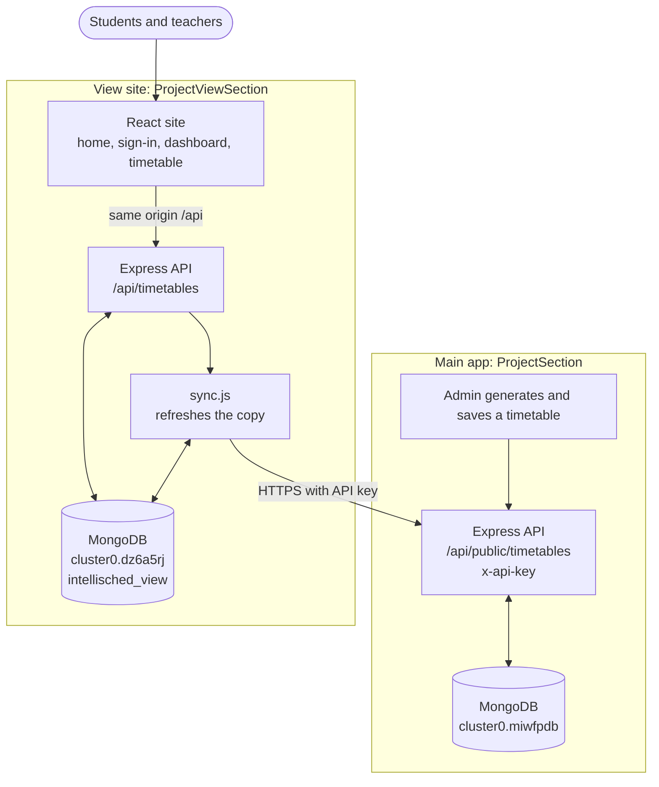

# IntelliSched View Site: Architecture

A read-only website for students and teachers. It gets timetables from the main IntelliSched app (`ProjectSection`) and never changes anything there. The reasons behind this design are in `DECISIONS.md`.

---

## 1. Principles

1. **Reading only.** Nothing on this site can change a timetable. Generating stays in the main app.
2. **One way in.** Data comes only through the main app's API, never from its database.
3. **Works alone.** Visitors are served from this site's own copy, so a main app outage doesn't take the site down.
4. **Least data.** The feed carries only what's needed to show a timetable.

## 2. Components

## 3. Backend (`backend/src`)

| File | Job |
|---|---|
| `server.js` | Checks settings at startup, serves the two public read routes, handles errors. |
| `sync.js` | Decides when the copy is stale, downloads changes from the main API, removes timetables the main app no longer has, records the result. |
| `db.js` | Connects to MongoDB, with a retry through public DNS for home routers that fail the SRV lookup. |

### Collections

| Collection | Contents |
|---|---|
| `timetables` | One document per timetable. `_id` is the main app's database id. Holds `name`, `generatedAt`, `scope`, `days`, `periods`, `entries`. |
| `meta` | One document, `_id: "sync"`: `attemptedAt`, `syncedAt`, `failed`. |

## 4. Frontend (`frontend/src`)

| File | Job |
|---|---|
| `App.jsx` | Hash routing, loading data, the remembered sign-in, the clock tick. |
| `timetable.js` | Pure logic: choices, joining lab periods into blocks, current and next class, stats, subject colours. |
| `pages/Landing.jsx` | Home page. |
| `pages/Access.jsx` | Role choice and Student or Teacher sign-in. |
| `pages/Portal.jsx` | Sidebar, dashboard, class view and list view. |
| `pages/Shared.jsx` | Logo, background shapes, loading and error states. |
| `Icons.jsx` | Inline icons. |
| `styles.css` | Colour tokens, layouts, phone and print rules. |

### Screens

| Route | Screen |
|---|---|
| `#/` | Home |
| `#/role` | Choose your role |
| `#/sign-in/student`, `#/sign-in/teacher`, `#/sign-in/master` | Sign in |
| `#/dashboard` | Stats, current or next class, today's classes, small week grid |
| `#/timetable` | Class view (week grid) and list view (one day) |

## 5. Security

- `MAIN_API_KEY` stays on the view backend and is never sent to the browser.
- The main app's feed rejects requests without the matching key.
- **`/api/timetables` on this site is public.** The Student and Teacher sign-in only chooses what to show (decision V6), so anyone with the link can read every timetable, including teacher names.
- The master account (decision V10) is checked on the server, but it only changes what the page offers. It doesn't protect any data.
- MongoDB, API and master account credentials live only in `backend/.env`, which is git-ignored.

## 6. Deployment

Same shape as the main app: one Vercel project using `vercel.json`, with `/api/*` going to the Express backend and everything else to the React build. In development, Vite on port 5180 proxies `/api` to port 4100. The main app's backend must also be deployed with `TIMETABLE_API_KEY`.
