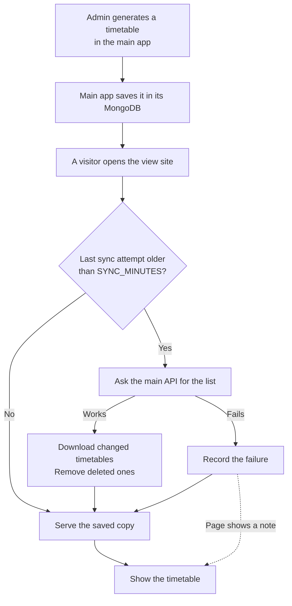
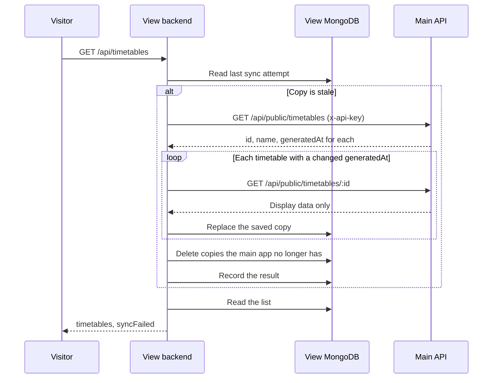
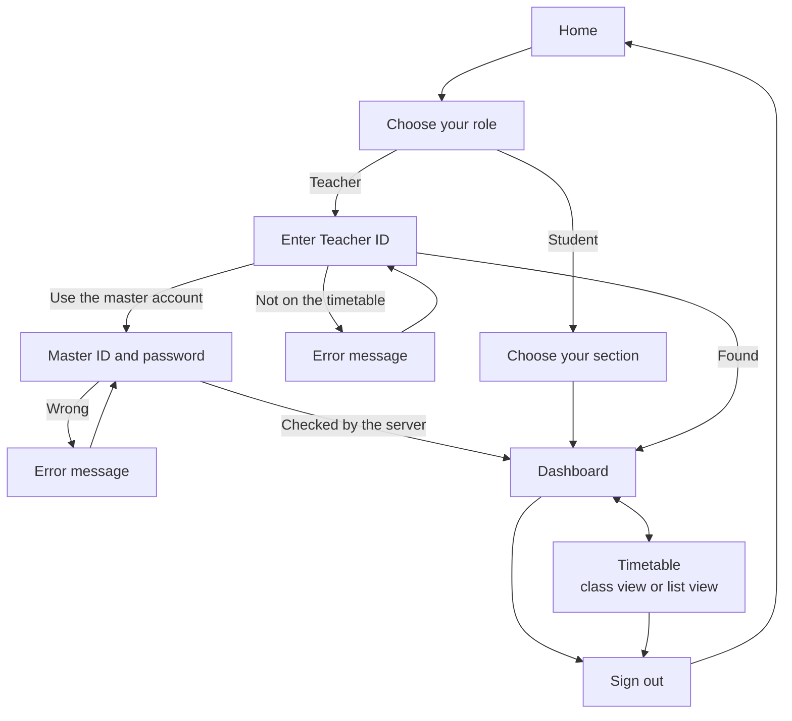

# IntelliSched View Site: Flow

How a saved timetable reaches a student or teacher. Diagrams are Mermaid; they render on GitHub and in VS Code with a Mermaid preview.

---

## 1. End to end

## 2. Sync

If the main API fails or rejects the key, the visitor still gets the saved copy with `syncFailed: true`, and the page says it may not be the latest version. If there's no saved copy at all, the page offers Try again.

## 3. What a visitor does

The choice is remembered in the browser, so returning visitors can go straight to `#/dashboard`. If that person is no longer on the timetable, they're sent back to choose a role. The master account sees the same pages, with a bar on top for switching between any teacher or section.

## 4. Building the display

1. `choices` lists the sections or teachers who appear in the entries.
2. `blocksFor` keeps one person's entries and joins each lab's two periods into one block, using `cont: true`.
3. `nowOrNext` compares today's blocks with the clock to find the class on now, or the next one, looking up to a week ahead. The page rechecks every 30 seconds.
4. `Week` places blocks on a grid with one row per period and break. `Agenda` lists one day. Below 860px, only `Agenda` shows.
